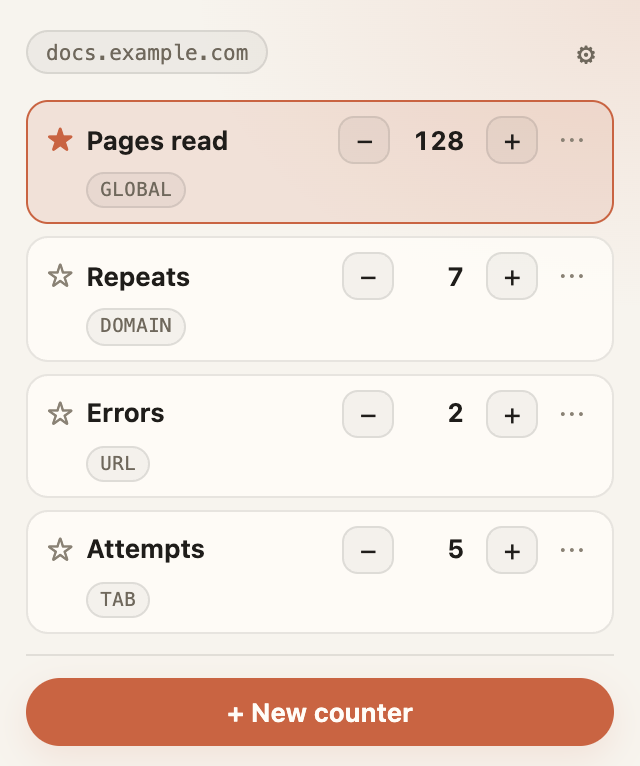
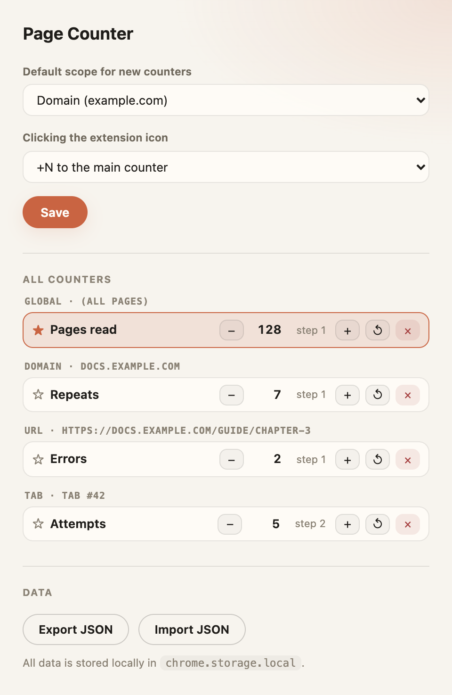

# Page Counter — count anything on a page

**English** · [Русский](README.ru.md)

A Chrome and Edge extension (Manifest V3) that counts anything on a page: repetitions,
attempts, mistakes, pages read. A counter does not know what a page means — you decide
what a click stands for. You can keep as many counters as you need, and each one belongs
to its own place: the whole browser, one domain, one exact URL, or a single tab.

No build step, no server, no account: plain JavaScript, and all data stays in the browser
profile.

| Popup | Settings and the counter manager |
|---|---|
|  |  |

The theme follows the system setting; the dark variant is in
[`docs/popup-dark.png`](docs/popup-dark.png) and [`docs/options-dark.png`](docs/options-dark.png).

The interface is bilingual: English by default, Russian when the browser UI language is
Russian. Russian screenshots: [`docs/popup.ru.png`](docs/popup.ru.png),
[`docs/options.ru.png`](docs/options.ru.png).

## Contents

- [What it is](#what-it-is)
- [Install](#install)
- [How to use](#how-to-use)
- [Scope](#scope)
- [Data](#data)
- [Tests](#tests)
- [Development](#development)
- [Limitations](#limitations)

## What it is

- **Any meaning.** "Pages read", "attempts", "mistakes", "chapters" — a counter has a name
  and a step, and you decide what it counts.
- **Four scopes.** `global`, `domain`, `url`, `tab`: from the whole browser down to one tab.
- **Several counters at once.** One of them is the main one and shows its value on the
  toolbar icon.
- **Keyboard first.** `Alt+↑`, `Alt+↓` and `Alt+0` work without opening the popup.
- **Everything local.** `chrome.storage.local` only: no network requests, no
  `host_permissions`, no content scripts.

## Install

There is no store listing, so the extension is loaded from source:

1. Open `chrome://extensions/` (in Edge — `edge://extensions/`)
2. Turn on **Developer mode** in the top right corner
3. **Load unpacked** → pick the repository folder
4. The icon appears on the toolbar

After code changes press 🔄 on the extension card so the browser re-reads the files.

## How to use

**Clicking the icon** adds the main counter's step to the current page (step 1 by default).
If there is no matching counter yet, one is created with the scope from settings and gets
the value 1. The step is a property of a counter and is set in its menu in the popup. In
settings the click can be re-assigned to "open the popup".

**The popup** shows the counters that belong to the current page:

- `★` — make it the main one; its number is shown on the icon
- click on a name — rename the counter
- click on a number — set the value manually
- `−` / `+` — step down and up by the counter's step
- `⋯` — menu: make main, rename, set value, initial value, step, reset, delete
- "New counter" — name, scope, starting value, step

**Right-click on the icon** gives reset of the main counter and a shortcut to the counter
manager.

**Hotkeys:** `Alt+↑` adds a step to the main counter, `Alt+↓` subtracts, `Alt+0` resets it.
`Alt+↑` also works on a page without counters: it creates one just like the icon click and
sets it to 1. All three can be re-assigned at `chrome://extensions/shortcuts`.

**Only the keyboard deletes counters.** `Alt+↓` down to zero and `Alt+0` remove the counter
from storage: there is nothing left to count, and a hotkey has no delete button to reach. With
the mouse a zero is just a value — `−` and `↺` in the popup and in the manager, or a manually
typed zero, leave the counter in the list next to its own delete button. A counter with an
initial value above zero is reset to that value. `Alt+↑` or a click on the icon creates it
again, with the value 1.

**The counter manager** lives on the settings page and shows every counter at once, grouped
by scope, not only the ones relevant to the current page. It is the place to fix a value when
you over- or under-clicked on some other site.

**The theme** follows the system: dark OS, dark popup and settings; light OS, light ones.
There is no separate theme switch — like the browser itself, the change happens live, without
a reload.

## Scope

The scope decides what a counter belongs to.

| Scope    | Area                                         |
|----------|----------------------------------------------|
| `domain` | All pages of one domain — the default        |
| `url`    | Exact address: origin + path + query         |
| `tab`    | One tab only                                 |
| `global` | One counter for the whole browser            |

The toolbar icon shows the main counter: the one marked as main among those that fit the
current page. `global` always fits, `domain` fits when the hostname matches, and so on.

## Data

Everything is stored in `chrome.storage.local`: on this machine, inside the browser profile.
The extension makes no network requests, has no `host_permissions` and does not read page
content — there are no content scripts.

Backup and moving — **Settings → Export JSON**, back through **Import JSON**. Import replaces
the current counters entirely; broken entries are dropped and the count of skipped ones is
shown.

## Tests

```bash
npm test
```

That is `node --test` with no external dependencies. The tests mock `chrome` and check the
service worker behaviour — for example, that the context menu is registered exactly once per
startup rather than twice.

## Development

Rules of the repository, the data model, architectural constraints and the list of known
traps live in [AGENTS.md](AGENTS.md) (in Russian). In short: no direct pushes to `main`, work
happens in a branch, tests are `npm test`.

There is no build step: the repository folder is the extension. The README is bilingual —
this file is the default, the Russian version is [README.ru.md](README.ru.md).

```
page-counter/
├── manifest.json        # MV3, service worker as an ES module
├── theme.css            # light/dark tokens, shared page base
├── background.js        # worker: badge, hotkeys, icon click and right-click, tab cleanup
├── lib/storage.js       # chrome.storage, Counter model, scope logic
├── lib/i18n.js          # interface strings: Russian and English dictionaries
├── _locales/            # manifest strings (description, hotkey descriptions) for Chrome
├── popup/               # counters of the current page
├── options/             # settings, manager of all counters, export and import
├── tests/               # node --test
├── docs/                # screenshots for this README
├── .githooks/           # pre-push: protection of main from direct pushes
├── AGENTS.md            # development rules for agents
└── icons/               # 16/48/128 PNG and the source SVG
```

## Limitations

- A counter counts **whole actions** and never goes below zero: there are no fractional
  values or steps, and it cannot become negative.
- **A `tab` counter disappears together with the tab.** That is the point: it belongs to one
  open tab, not to a site. Need a long-lived one — use `domain` or `url`.
- The toolbar icon shows only the main counter of the active tab. Other counters never
  appear there.
- The main counter is one per context: making another one main clears the flag on the
  previous one.
- **The interface has two languages: English and Russian.** The language follows the browser
  UI language, and there is no separate switch inside the extension; any other locale falls
  back to English.
