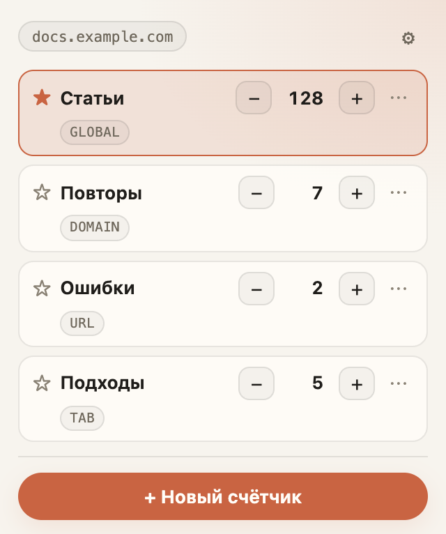
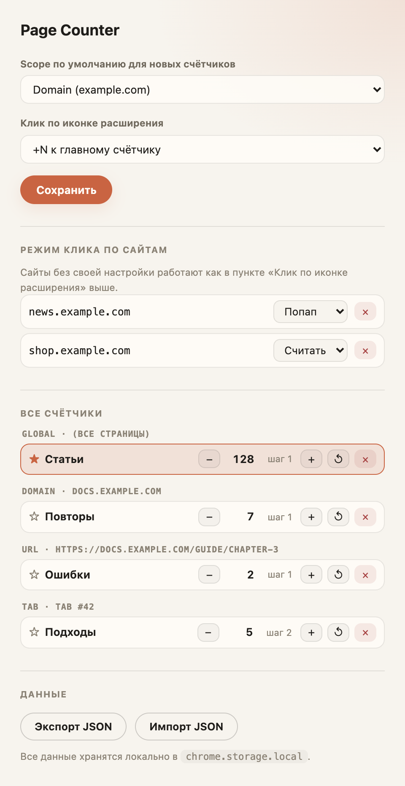

# Page Counter — считает что угодно на странице

[English](README.md) · **Русский**

Расширение для Chrome и Edge (Manifest V3), которое считает что угодно на странице:
повторы, подходы, ошибки, потраченные страницы. Счётчик не знает, что значит страница, —
смысл клику задаёте вы. Счётчиков может быть сколько угодно, и каждый привязан к своему
«месту»: ко всему браузеру, к домену, к конкретному адресу или к одной вкладке.

Ни сборки, ни сервера, ни аккаунта: чистый JS, всё лежит локально в профиле браузера.

| Попап | Настройки и менеджер счётчиков |
|---|---|
|  |  |

Тема следует за системой; тёмный вариант — в [`docs/popup-dark.ru.png`](docs/popup-dark.ru.png) и
[`docs/options-dark.ru.png`](docs/options-dark.ru.png).

Интерфейс двуязычный: английский по умолчанию и русский, если интерфейс браузера русский.
Английские скриншоты: [`docs/popup.png`](docs/popup.png), [`docs/options.png`](docs/options.png).

## Содержание

- [Что это](#что-это)
- [Установка](#установка)
- [Как пользоваться](#как-пользоваться)
- [Scope](#scope)
- [Данные](#данные)
- [Тесты](#тесты)
- [Разработка](#разработка)
- [Ограничения](#ограничения)

## Что это

- **Любой смысл.** «Статьи», «подходы», «ошибки», «главы» — у счётчика есть имя и шаг, а
  что он считает, решаете вы.
- **Четыре scope.** `global`, `domain`, `url`, `tab`: от всего браузера до одной вкладки.
- **Несколько счётчиков сразу.** Один из них главный — его значение видно на иконке в тулбаре.
- **Сначала клавиатура.** `Alt+↑`, `Alt+↓` и `Alt+0` работают, не открывая попап.
- **Всё локально.** Только `chrome.storage.local`: ни сетевых запросов, ни `host_permissions`,
  ни контент-скриптов.

## Установка

В сторе расширения нет, ставится из исходников:

1. Открыть `chrome://extensions/` (в Edge — `edge://extensions/`)
2. Включить **Режим разработчика** в правом верхнем углу
3. **Загрузить распакованное расширение** → выбрать папку с репозиторием
4. На тулбаре появится иконка

После правок в коде — кнопка 🔄 на карточке расширения, чтобы браузер перечитал файлы.

## Как пользоваться

**Клик по иконке** прибавляет к главному счётчику текущей страницы его шаг (по умолчанию 1).
Если подходящего счётчика ещё нет, он создастся сам со scope из настроек и сразу получит
значение 1. Шаг — свойство счётчика, задаётся в его меню в попапе. В настройках клик можно
переназначить на «открыть попап».

**Попап** показывает счётчики, которые относятся к текущей странице:

- `★` — сделать главным; его число видно на иконке
- клик по имени — переименовать
- клик по числу — задать значение вручную
- `−` / `+` — шаг вниз и вверх (шаг счётчика)
- `⋯` — меню: сделать главным, переименовать, задать значение, начальное значение, шаг,
  сбросить, удалить
- «+ Новый счётчик» — имя, scope, стартовое значение, шаг

**Правый клик по иконке** — сбросить главный счётчик, сразу открыть менеджер счётчиков и галочка
**«Попап по клику на этом сайте»**.

**Режим клика можно задать по сайтам.** Пункт в настройках — это режим по умолчанию для всего;
один сайт может его переопределить этой галочкой: правый клик по иконке на нём — и там иконка
открывает попап, а остальные сайты в это же время считают кликом. На странице настроек есть
список **«Режим клика по сайтам»** со всеми переопределениями: там их можно переключить или
убрать. Сайты без своей настройки живут по общему режиму. Хоткеи считают на любом сайте в любом
режиме.

**Хоткеи:** `Alt+↑` прибавить шаг главного счётчика, `Alt+↓` убавить, `Alt+0` сбросить главный
счётчик. `Alt+↑` работает и на странице без счётчиков: он заведёт счётчик так же, как клик по
иконке, и поставит 1. Переназначаются на `chrome://extensions/shortcuts`.

**Обнуление стирает счётчик только с клавиатуры.** `Alt+↓` до конца и `Alt+0` убирают счётчик
из памяти: считать в нём нечего, а сочетанием клавиш до кнопки удаления не дотянуться. Мышью
спокойнее — «−» и «↺» в попапе и менеджере и ручной ноль просто ставят значение, счётчик
остаётся в списке, рядом с ним своя кнопка удаления. Счётчик с начальным значением больше нуля
сбрасывается в это значение. Заново счётчик заводит `Alt+↑` или клик по иконке — со значением 1.

**Менеджер счётчиков** живёт на странице настроек и показывает сразу все счётчики,
сгруппированные по scope, — не только те, что относятся к текущей странице. Здесь удобно
поправить значение, если пере- или недокликал, находясь уже на другом сайте.

**Тема** следует за системой: при тёмном режиме ОС попап и настройки тёмные, при светлом —
светлые. Отдельного переключателя темы нет — как и у самого браузера, смена происходит на лету,
без перезагрузки.

## Scope

Scope решает, к чему привязан счётчик.

| Scope    | Область                                      |
|----------|----------------------------------------------|
| `domain` | Все страницы одного домена — по умолчанию    |
| `url`    | Точный адрес: origin + путь + query          |
| `tab`    | Только одна вкладка                          |
| `global` | Один на весь браузер                         |

На иконке показывается главный счётчик — тот, что выбран среди подходящих текущей странице.
`global` подходит всегда, `domain` — если совпал домен, и так далее.

## Данные

Всё хранится в `chrome.storage.local`: на этой машине, в профиле браузера. Расширение не делает
сетевых запросов, не имеет `host_permissions` и не читает содержимое страниц — контент-скриптов
в нём нет.

Бэкап и перенос — **Настройки → Экспорт JSON**, обратно через **Импорт JSON**. Импорт заменяет
текущие счётчики целиком: битые записи отбрасываются, число пропущенных показывается человеку.

## Тесты

```bash
npm test
```

Это `node --test` без внешних зависимостей. Тесты мокают `chrome` и проверяют поведение service
worker'а — например, что контекстное меню регистрируется ровно один раз за старт, а не дважды.

## Разработка

Сборки нет: папка репозитория и есть расширение. Тесты — `npm test` (`node --test` на моке
`chrome`). История — это PR и `git log`, откат — `git revert` или кнопка Revert у PR.

README двуязычный — этот файл русский, английская версия по умолчанию лежит в
[README.md](README.md).

```
page-counter/
├── manifest.json        # MV3, service worker как ES-модуль
├── theme.css            # токены светлой и тёмной темы, общая база страниц
├── background.js        # воркер: бейдж, хоткеи, клик и ПКМ по иконке, автоочистка
├── lib/storage.js       # chrome.storage, модель Counter, логика scope
├── lib/i18n.js          # строки интерфейса: русский и английский словари
├── _locales/            # строки манифеста (описание, хоткеи) для Chrome
├── popup/               # счётчики текущей страницы
├── options/             # настройки, менеджер всех счётчиков, экспорт и импорт
├── tests/               # node --test
├── docs/                # скриншоты для README
├── .githooks/           # pre-push: защита main от прямых пушей
└── icons/               # 16/48/128 PNG + исходный SVG
```

## Ограничения

- Счётчик считает **целые действия** и не уходит ниже нуля: дробных значений и шагов не бывает,
  в минус он тоже не уходит.
- **Счётчик со scope `tab` исчезает вместе с вкладкой.** Так и задумано: он привязан к
  конкретному открытому табу, а не к сайту. Нужен долгоживущий — берите `domain` или `url`.
- На иконке видно только главный счётчик активной вкладки. Остальные счётчики там не мелькают.
- Главный счётчик один на контекст: если сделать главным другой, прежний теряет флаг.
- **В интерфейсе два языка: английский и русский.** Язык берётся из системы — из языка
  интерфейса браузера; своей настройки языка в расширении нет, а любая другая локаль
  показывается по-английски.
